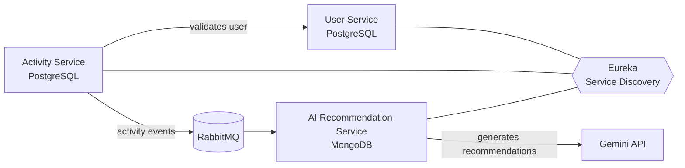

<h1 align="center">Hi, I'm Shubham Keluskar 👋</h1>
<h3 align="center">Java Backend Developer · Spring Boot · Microservices · Oracle SQL</h3>

  
  
  

  
  

---

## 🚀 About Me

I'm a **Java backend developer with 1+ year of production experience** building, debugging and optimizing backend systems on **Java + Oracle SQL**. I work comfortably with senior engineers on live production issues, and I enjoy turning slow, manual, error-prone things into fast, automated, reliable ones.

**What I bring to a team:**

- 🛠️ **Production-ready mindset**: shipped hotfixes in Java and traced critical issues through logs, code and database data
- ⚡ **Performance focus**: cut Oracle SQL query execution time by **30%+**
- 🤖 **Automation**: replaced **6 recurring manual batch jobs** with shell scripts + cron + email alerts
- 🧩 **Microservices**: built an event-driven system with Spring Boot, Eureka and RabbitMQ
- 🏆 **2nd Runner-Up**, internal AI Hackathon at VIP
- 📚 Fast learner, collaborative, and comfortable owning a task end to end

---

## 💼 Experience

### Software Engineer Trainee, VIP · Mumbai
*July 2025 – Oct 2026*

| Impact | What I did |
|---|---|
| 🐞 **Production hotfixes** | Delivered hotfixes in **Java** alongside senior engineers, fixing defects in backend code |
| 🔍 **Root-cause debugging** | Traced critical production issues across **application logs, Java code and Oracle data (DBeaver)** |
| ⚡ **Query optimization** | Optimized slow **Oracle SQL** queries, reducing execution time by **30%+** |
| 🤖 **Automation** | Automated **6 recurring batch jobs** with **shell scripts + cron**, with email alerts, replacing manual runs |

---

## 🛠️ Tech Stack

**Core (Backend)**

  
  
  
  
  
  

**Databases and Messaging**

  
  
  
  
  

**Tools and DevOps**

  
  
  
  
  
  
  
  

**Also comfortable with**

  
  
  
  
  
  
  

---

## ⭐ Featured Project: Fitness Tracker Microservices

> An event-driven microservices system in **Java + Spring Boot** that tracks user activities and generates **AI-powered recommendations** using the Gemini API.

**Tech:** `Java` `Spring Boot` `Spring Data JPA` `PostgreSQL` `MongoDB` `RabbitMQ` `Eureka` `REST APIs`

**Highlights**

- 🧱 Built **user, activity and AI-recommendation microservices** with REST APIs, using **PostgreSQL (Spring Data JPA)** and **MongoDB**
- 🔗 Set up **Eureka service discovery** so services register and call each other, with the activity service **validating users before saving activities**
- 📨 Used **RabbitMQ** to publish activity events asynchronously to the AI service, which calls the **Gemini API** for personalized recommendations

👉 **[View the repository](https://github.com/shubhamkeluskar/fitness-tracker-microservices)**

---

## 📂 More Projects

| Project | What it does | Tech |
|---|---|---|
| 🚗 **[Sawari](https://github.com/shubhamkeluskar/sawari)** | Full-stack ride app with a responsive UI, Express REST APIs and MongoDB CRUD for user and ride data | React, Tailwind CSS, JavaScript, Express, MongoDB |
| 📄 **[LOR Management System](https://github.com/shubhamkeluskar/lor-management-system)** | Letter of Recommendation workflow for students, faculty and HOD, with a PHP backend and MySQL storage | HTML, CSS, JavaScript, PHP, MySQL |

---

## 🎓 Education and Certifications

- **B.E. Computer Science**, Mumbai University (2021 – 2025) · CGPA 7.9
  *Data Structures · OOPs · DBMS · Operating Systems · Computer Networks · Machine Learning · AI*
- 📜 **Udemy:** Web Development Bootcamp 2024
- 📜 **Udemy:** Oracle SQL Bootcamp 2025
- 🏆 **2nd Runner-Up:** VIP internal AI Hackathon

---

## 📊 GitHub Stats

  
  

  

---

## 🤝 Let's Work Together

I'm actively looking for a **Software Developer / Java Backend Developer** role where I can contribute to real production systems from day one and keep growing fast.

📫 **Email:** [shubham57228@gmail.com](mailto:shubham57228@gmail.com)
💼 **LinkedIn:** [linkedin.com/in/shubhamkeluskar](https://linkedin.com/in/shubhamkeluskar)
📍 **Based in:** Mumbai, India (open to relocation and remote)

<i>If you're hiring, I'd love to talk. I reply fast. 🚀</i>

