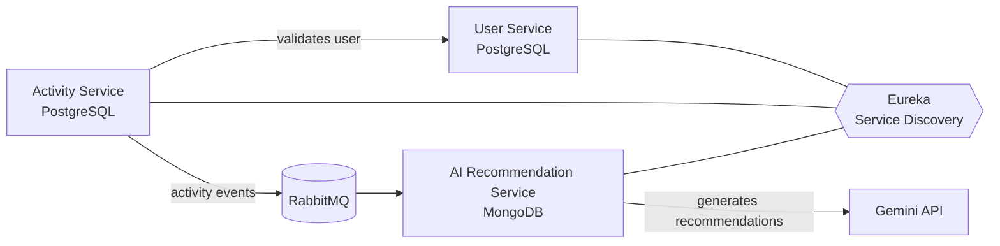

<!-- Header banner -->
<p align="center">
  
</p>

<!-- Typing animation -->
<p align="center">
  <a href="https://git.io/typing-svg">
    
  </a>
</p>

<p align="center">
  
  
  
  
</p>

<p align="center">
  <a href="https://www.linkedin.com/in/shubham-keluskar-16397b1a0/"></a>
  <a href="mailto:shubham57228@gmail.com"></a>
  <a href="tel:+918779102650"></a>
</p>

---

## ⚡ TL;DR (for recruiters)

| | |
|---|---|
| 🎯 **Role I'm looking for** | Software Developer / Java Backend Developer |
| 💪 **Strengths** | Java, Spring Boot, Microservices, Oracle SQL, production debugging |
| 📈 **Proven impact** | **30%+ faster SQL queries** · **6 batch jobs automated** · **production hotfixes shipped** |
| 🏆 **Recognition** | 2nd Runner-Up, VIP internal AI Hackathon |
| 📍 **Location** | Mumbai, India (open to relocation and remote) |
| ⏱️ **Availability** | Ready to join quickly. **Call or email anytime.** |
| 📞 **Phone** | **[+91 87791 02650](tel:+918779102650)** |
| ✉️ **Email** | **[shubham57228@gmail.com](mailto:shubham57228@gmail.com)** |

---

## 🚀 About Me

I'm a **Java backend developer with 1+ year of production experience** building, debugging and optimizing backend systems on **Java + Oracle SQL**. I work comfortably with senior engineers on live production issues, and I love turning slow, manual, error-prone things into fast, automated, reliable ones.

```java
public class ShubhamKeluskar implements BackendDeveloper {

    String role       = "Java Backend Developer";
    String[] coreStack = {"Java", "Spring Boot", "Spring Data JPA", "Microservices", "Oracle SQL"};
    String[] datastores = {"Oracle", "PostgreSQL", "MySQL", "MongoDB"};
    String messaging  = "RabbitMQ";
    String location   = "Mumbai, India";
    boolean openToWork = true;

    public String whyHireMe() {
        return "Production-ready, performance-focused, automation-minded, fast learner.";
    }
}
```

**What I bring to your team:**

- 🛠️ **Production-ready mindset:** shipped hotfixes in Java and traced critical issues through logs, code and database data
- ⚡ **Performance focus:** cut Oracle SQL query execution time by **30%+**
- 🤖 **Automation:** replaced **6 recurring manual batch jobs** with shell scripts, cron and email alerts
- 🧩 **Microservices:** built an event-driven system with Spring Boot, Eureka and RabbitMQ
- 📚 **Fast learner and team player:** collaborative, comfortable owning a task end to end

---

## 💼 Experience

### Software Engineer Trainee · VIP · Mumbai
*July 2025 – Oct 2026*

| Impact | What I did |
|---|---|
| 🐞 **Production hotfixes** | Delivered hotfixes in **Java** alongside senior engineers, fixing defects in backend code |
| 🔍 **Root-cause debugging** | Traced critical production issues across **application logs, Java code and Oracle data (DBeaver)** |
| ⚡ **Query optimization** | Optimized slow **Oracle SQL** queries, reducing execution time by **30%+** |
| 🤖 **Automation** | Automated **6 recurring batch jobs** with **shell scripts + cron**, with email alerts, replacing manual runs |

---

## 🛠️ Tech Stack

### ☕ Backend and Core

<p>
  
  
  
  
  
</p>

### 🗄️ Databases and Messaging

<p>
  
  
  
</p>

### 🧰 Tools and DevOps

<p>
  
  
</p>

### 🌐 Also Comfortable With

<p>
  
</p>

### 🤖 AI

<p>
  
</p>

---

## ⭐ Featured Project: Fitness Tracker Microservices

> An event-driven microservices system in **Java + Spring Boot** that tracks user activities and generates **AI-powered recommendations** using the Gemini API.

<p>
  
</p>



**Highlights**

- 🧱 Built **user, activity and AI-recommendation microservices** with REST APIs, using **PostgreSQL (Spring Data JPA)** and **MongoDB**
- 🔗 Set up **Eureka service discovery** so services register and call each other, with the activity service **validating users before saving activities**
- 📨 Used **RabbitMQ** to send activity events asynchronously to the AI service, which calls the **Gemini API** for personalized recommendations

👉 **[View the repository](https://github.com/shubhamkeluskar/fitness-tracker-microservices)**

---

## 📂 More Projects

| Project | What it does | Tech |
|---|---|---|
| 🚗 **[Sawari](https://github.com/shubhamkeluskar/sawari)** | Full-stack ride app with a responsive UI, Express REST APIs and MongoDB CRUD for user and ride data | React, Tailwind CSS, JavaScript, Express, MongoDB |
| 📄 **[LOR Management System](https://github.com/shubhamkeluskar/lor-management-system)** | Letter of Recommendation workflow for students, faculty and HOD, with a PHP backend and MySQL storage | HTML, CSS, JavaScript, PHP, MySQL |

---

## 🎓 Education, Certificates and Achievements

- 🎓 **B.E. Computer Science**, Mumbai University (2021 – 2025) · CGPA 7.9
  *Data Structures · OOPs · DBMS · Operating Systems · Computer Networks · Machine Learning · AI*
- 📜 **Udemy:** Web Development Bootcamp 2024
- 📜 **Udemy:** Oracle SQL Bootcamp 2025
- 🏆 **2nd Runner-Up:** VIP internal AI Hackathon

---

## 📊 GitHub Stats

<p align="center">
  
  
</p>

<p align="center">
  
</p>

<p align="center">
  
</p>

---

## 🤝 Let's Build Something Great Together

I'm actively looking for a **Software Developer / Java Backend Developer** role where I can contribute to real production systems from day one. **If you're hiring, let's talk.**

<p align="center">
  <a href="tel:+918779102650"></a>
  <a href="mailto:shubham57228@gmail.com"></a>
  <a href="https://www.linkedin.com/in/shubham-keluskar-16397b1a0/"></a>
</p>

<p align="center">
  
</p>
